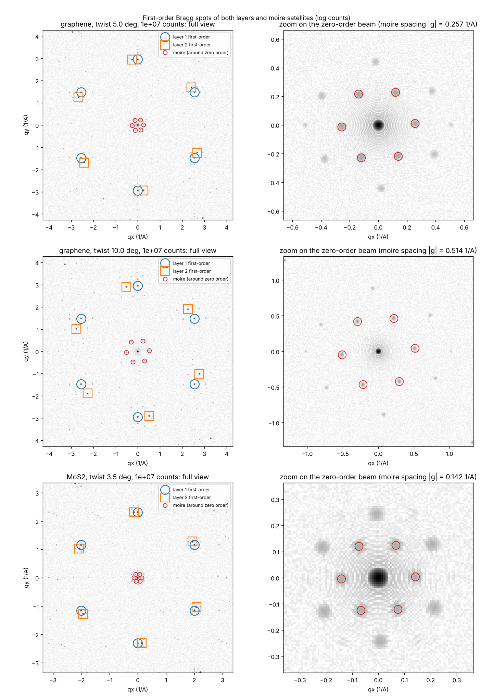

# TwistScope

**Read the twist angle of a 2D bilayer from its electron diffraction pattern, or simulate the pattern for any twist angle.**

Twisting one atom-thin layer against another changes how a material conducts electricity and emits light. At 1.1°, twisted bilayer graphene becomes a superconductor. TwistScope measures that twist angle automatically, and it also tells you how sure it is.

**Try it in your browser:** https://ingemar0803.github.io/twistscope/ (no installation needed)



## What it does

| Direction | Input | Output |
|---|---|---|
| **Simulate** | two layers (graphene, hBN, MoS₂, WS₂, MoSe₂ or WSe₂) and a twist angle | the diffraction pattern and the real-space moiré pattern |
| **Measure** | an electron diffraction pattern, or a microscope image of the atoms or moiré (STM, AFM, TEM) | the twist angle ± uncertainty, plus the likely material when the image scale is known |

### How the measurement works

1. Find the bright spots in the pattern.
2. Find the centre of the pattern from the midpoints of pairs of opposite spots. This works even when a beam stop hides the centre.
3. Correct sideways image stretching by making the rings of spots circular.
4. Group spots into rings at equal distance from the centre.
5. Multiply each spot's direction by 6, so all six spots from one layer point the same way, then split the spots into two groups (one per layer).
6. The twist angle is the gap between the two groups divided by 6. The uncertainty comes from the scatter within each group.

For real-space images, the tool first takes a Fourier transform, which turns the image into a computed diffraction pattern, and then runs the same steps.

### How the simulation works

The simulation uses kinematic (single-scattering) diffraction theory: the pattern is the Fourier transform of the atom positions. The faint moiré spots near the central beam need electrons that scatter off both layers. Their brightness is set by a parameter α, which is chosen by hand and is not a measured constant. Their positions depend only on geometry.

## Results

| Test | Result |
|---|---|
| Simulated patterns, 2° to 30°, graphene and MoS₂ | twist angle recovered to within 0.04° |
| Highest noise (20 counts in the brightest spot), 3° and up | within 0.03° |
| 2% strain in one layer, or 8-pixel off-centre shift | angle moved by at most 0.03° |
| Below 2° | unreliable, because the two layers' spots overlap |
| Published patterns reported as 16° and 24° | measured 16.1° ± 0.5° and 25.5° ± 0.1° (images were stretched by 10–27%) |

## Repository contents

```
index.html               the web app (one self-contained page; open it in any browser)
python/
  twistsim.py            simulator and twist-angle extractor (core library)
  run_experiments.py     accuracy tests: 13 angles x 3 noise levels x 8 seeds, plus strain and shift
  moire_zero_order.py    how visible the moiré spots are at different electron counts
  moire_with_first_order.py  first-order spots together with the moiré spots
  moire_16_24.py         moiré spots at 16° and 24° as α increases
  real_saed_extract.py   measure the twist from published diffraction images
  sim_vs_real.py         reverse test: simulate the reported angles and overlay the real spots
figures/                 example output
```

## Running the Python code

```bash
pip install -r requirements.txt
cd python
python run_experiments.py           # writes results/ (CSV and figures)
python moire_with_first_order.py    # writes results_moire/
```

Quick check:

```python
import numpy as np, twistsim as t
p = t.simulate_pattern("graphene", 10.0)                      # simulate 10° twisted bilayer graphene
I = t.add_noise(p, 100, rng=np.random.default_rng(1))          # 100 counts in the brightest spot
print(t.extract_twist(I, p.dq, t.G_first("graphene"))["theta"])  # about 10.00
```

`real_saed_extract.py`, `sim_vs_real.py` and `moire_16_24.py` need the published figure, which is not included here for copyright reasons. See [`python/real_data/README.md`](python/real_data/README.md).

## Limitations

- Kinematic theory only. It ignores multiple scattering and the way atoms shift (relax) inside a moiré pattern.
- The moiré brightness α is a chosen setting, not a measurement.
- Twist angles below about 2° cannot be resolved from the first-order spots.
- Only three real published patterns have been tested so far.

## Data sources

- Real diffraction patterns: *Raman spectra of twisted CVD bilayer graphene*, Carbon 123, 302 (2017).
- Lattice constants: typical literature values (graphene 2.46 Å, hBN 2.50 Å, MoS₂ 3.16 Å, WS₂ 3.15 Å, MoSe₂ 3.29 Å, WSe₂ 3.28 Å).

## Use of AI

This project was built with help from an AI assistant (Claude), which helped write and debug the code. All results come from running the code in this repository.

## Licence

MIT. See [LICENSE](LICENSE).
